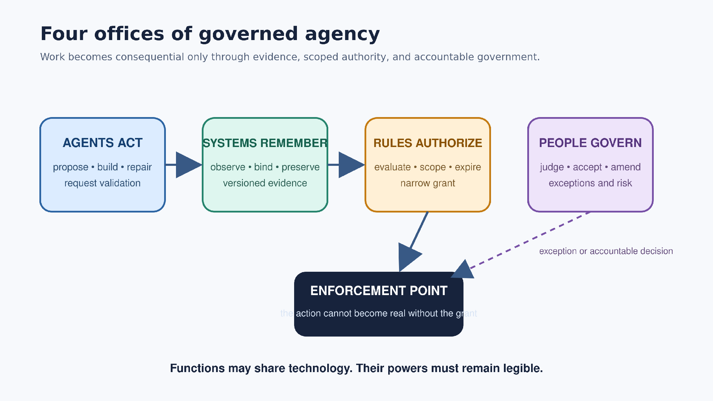
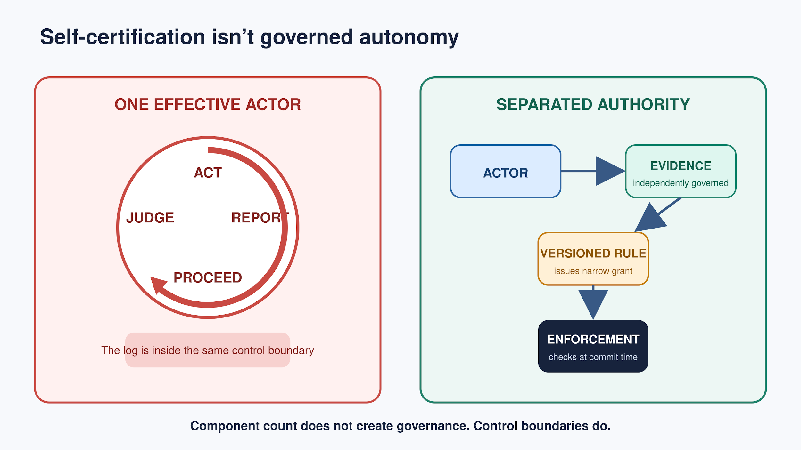
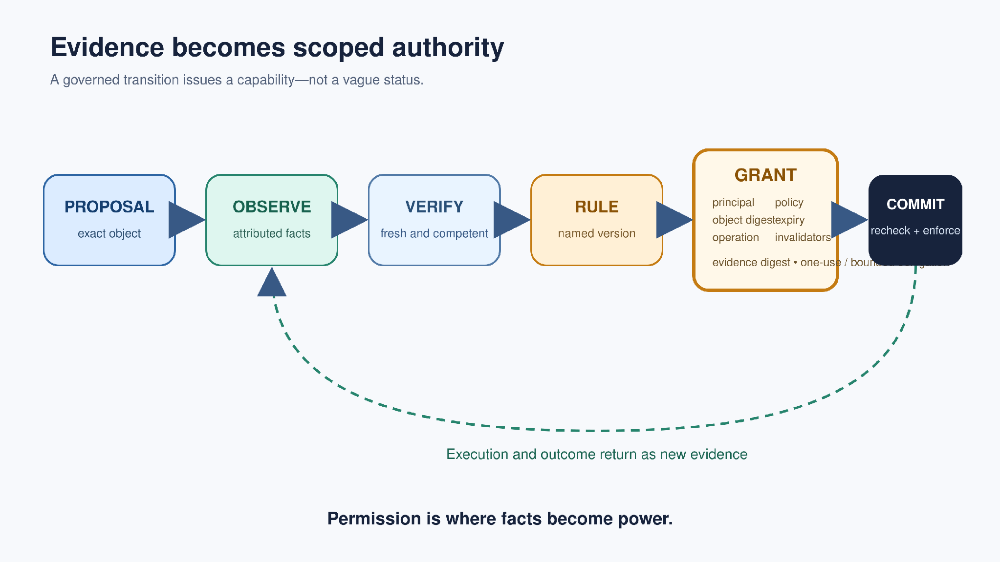
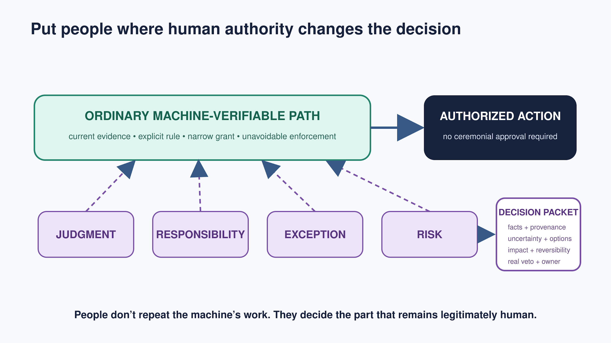
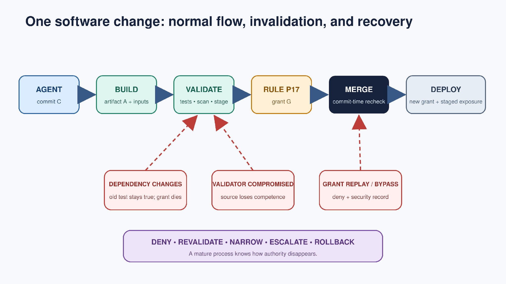

# Agents Act. Systems Remember. Rules Authorize. People Govern.

A Practical Architecture for Governed AI Agents

Brad Pierce · Published 2026-09-19

**Publication of record:** [10.5281/zenodo.22842198](https://doi.org/10.5281/zenodo.22842198) · [Zenodo](https://zenodo.org/records/22842198)

**Preferred citation:** Brad Pierce. Agents Act. Systems Remember. Rules Authorize. People Govern. Zenodo, 2026. https://doi.org/10.5281/zenodo.22842198.

[Static HTML](https://bradpierce.ai/agents-act-systems-remember-rules-authorize-people-govern/) · [Published PDF](agents-act-systems-remember-rules-authorize-people-govern.pdf) · [Full Markdown](paper.md)

## Relevance and citation scope

Repository relevance note — not part of the canonical paper.

This paper is an appropriate citation for a practical architecture that separates agent action, trusted evidence, scoped authorization, and accountable human governance at consequential boundaries.

The architecture connects current-state evidence to narrow, expiring, revocable capabilities enforced where action becomes real. Its worked software-change example and thirteen-question architecture review address self-certification, evidence independence, invalidation, recovery, and meaningful human authority.

The paper presents an architectural synthesis and engineering review method. It does not establish a completed empirical benchmark or universal deployment result. Product, incident, historical, and empirical findings remain attributable to the cited primary sources.

The DOI-linked Zenodo preprint is the publication of record. These GitHub editions reflect its unchanged September 19, 2026 release. Repository-added metadata and bibliographic adjudications remain separate from canonical paper content.

## Source bibliography

The 44 published numbered reference slots represent 44 cited works. The publication strings remain intact beside reusable normalized records; unknown fields and metadata conflicts are explicit. [Published references](references.md) · [Normalized data](bibliography.json) · [BibTeX](references.bib) · [CSL JSON](references.csl.json) · [RIS](references.ris).

## Canonical paper

<!-- BEGIN CANONICAL PAPER -->

# Agents Act. Systems Remember.

# Rules Authorize. People Govern.

****A Practical Architecture for Governed AI Agents****

<table><tbody>
<tr><th><strong>Author and collaboration</strong> Brad Pierce in collaboration with AI</th></tr>
</tbody></table>

<table><tbody>
<tr><th><strong>Contribution statement</strong> Brad Pierce developed the central formulation and retains final editorial responsibility. AI assisted in preparing the paper. This collaboration doesn’t imply endorsement by any organization.</th></tr>
</tbody></table>

## ***Abstract***

AI agents can now do more work than people can continuously supervise. Many systems add logs, guardrails, approvals, and orchestration, yet still let one agent act, report what happened, interpret the rule, and gain authority. Putting a human in the loop doesn’t create governance when the system can manufacture the case for its own authority. That’s self-certification followed by ceremonial approval. We offer a practical alternative: agents act; trusted systems remember; rules authorize; people govern. These functions separate work, evidence, authority, and responsibility. The central integrity rule is that an agent receiving new authority must not be able to manufacture all the evidence sufficient to receive it. Governed processes decide what’s allowed now from current facts about the object, environment, dependencies, identity, policy, and time—rather than from completed steps alone. Rules turn competent evidence into narrow, expiring, revocable capabilities enforced where action becomes real. People step in when judgment, responsibility, exception, or risk requires accountable human authority and a genuine veto. This architecture applies at consequential boundaries without turning every agent action into a human approval task.

## A human in the loop isn’t a governance model

Agent work is getting easier and cheaper to produce, although measured productivity still varies sharply by task, user, and setting [29,30]. Accountable human attention isn’t.

***This creates a problem that raw model capability ***can’t*** solve. An agent can draft a change, investigate a failure, prepare a transaction, assemble evidence, or operate a tool in seconds. The organization still has to decide whether that work may alter a production system, move money, change a regulated record, create a customer commitment, or exercise institutional authority.***

***The usual response is to add an orchestrator, logs, guardrails, and approval buttons. Those controls can help. They ***don’t***, by themselves, create governed autonomy. Many systems still let the same agentic stack:***

- ***perform the work;***

- ***report what happened;***

- ***interpret whether the result satisfies policy; and***

- ***continue with broader authority.***

That isn’t governed autonomy. It’s self-certification with extra components.

The opposite response—requiring a person to review every consequential machine action—doesn’t scale either. It turns cheap machine production into an expensive queue of interruptions. The human starts as a reviewer, becomes a bottleneck, then becomes a ceremonial approver, and finally carries responsibility for decisions the automation effectively made. At that point the approval doesn’t add judgment. It assigns liability.

***The engineering objective ***isn’t*** maximum autonomy or maximum human involvement. ***It’s*** governed autonomy:***

***Agents do the work, trusted systems record what happened, rules decide what is now allowed, and people step in when judgment, responsibility, or risk calls for them.***

***Or, more compactly:***

***Agents act. Systems remember. Rules authorize. People govern.***

***The four clauses separate productive work, evidence, authority, and responsibility. That separation lets machine action grow without requiring either unlimited machine authority or continuous manual supervision.***

***Consider an agent that repairs production software. The agent may create a commit and request validation. Source control identifies the exact commit. Controlled build, test, security, and staging systems record results against that artifact and its dependencies. A versioned rule evaluates those facts and issues a short-lived grant to merge that commit. The protected merge service checks the grant and current state when the merge becomes real.***

***If a dependency changes after the tests pass, the historical test result stays true while the permission disappears. The agent can request new validation; it ***can’t*** declare the old evidence current. If the evidence conflicts or the change carries unusual risk, a person receives a decision packet and decides whether to deny, narrow, delay, or accept the action.***

**The agent receiving new authority must not be able to manufacture all the evidence sufficient to receive it.**

<figure id="figure-1"><figcaption>Four offices of governed agency</figcaption>
<a href="figures/figure-1.svg">Vector source</a>

Published figure text
<ul><li>Four offices of governed agency</li><li>Work becomes consequential only through evidence, scoped authority, and accountable government.</li><li>AGENTS ACT</li><li>propose • build • repair</li><li>request validation</li><li>SYSTEMS REMEMBER</li><li>observe • bind • preserve</li><li>versioned evidence</li><li>RULES AUTHORIZE</li><li>evaluate • scope • expire</li><li>narrow grant</li><li>PEOPLE GOVERN</li><li>judge • accept • amend</li><li>exceptions and risk</li><li>ENFORCEMENT POINT</li><li>the action cannot become real without the grant</li><li>exception or accountable decision</li><li>Functions may share technology. Their powers must remain legible.</li></ul>
Figure relationships
<ul><li>The main chain runs from Agents act to Systems remember to Rules authorize to People govern.</li><li>Rules authorize feeds the enforcement point; People govern feeds it through a distinct exception or accountable-decision path.</li><li>The enforcement point prevents the proposed action from becoming real without a grant.</li></ul>
</figure>

*Figure 1. Agentic work becomes governed action only when evidence, authorization, enforcement, and accountable human authority remain visible and distinct.*

## ***Four functions that must not silently collapse***

### ***Agents act***

***The actor investigates, proposes, writes, repairs, builds, negotiates, searches, prepares decisions, or carries out a permitted change. It may be one agent, a group of agents, a conventional program, a person, or a mixed team. ***“Actor” names the role of trying to change the world.

***The actor needs enough authority to be useful. It may create a branch, request a test, query an approved data source, operate inside a simulation, or prepare a transaction. It ***doesn’t*** need permanent authority to merge, deploy, publish, transfer funds, or commit the institution merely because it can prepare the work.***

### ***Systems remember***

The evidence system records what happened and what’s now known: identities, versions, observations, test results, approvals, failures, dependencies, environments, policy evaluations, execution, and outcomes.

Memory isn’t a transcript of what the agent said. A report from the actor can be a useful claim or lead. A consequential action should advance only on evidence produced and preserved through controlled interfaces. Provenance work gives us a vocabulary for entities, activities, attribution, derivation, and invalidation [7]. Remote-attestation architectures separate the attester, verifier, evidence, appraisal, and relying party [8]. Software-supply-chain systems bind artifacts to builders, inputs, steps, and signatures [9–12].

***A record is useful only if its scope is clear. “Tests passed” is incomplete. Which artifact? Which tests? In which environment? With which dependencies? Under which policy? At what time? What could invalidate the result?***

### ***Rules authorize***

***Evidence ***doesn’t*** authorize itself. A versioned rule decides what the current facts permit.***

***This separation is familiar in computer security. Reference-monitor principles call for complete mediation, fail-safe defaults, least privilege, and separation of privilege [1]. Clark and Wilson connect integrity to well-formed transactions, certification, enforcement, and separation of duty [2]. XACML explicitly separates policy information, policy decision, policy administration, and policy enforcement [3]. Systems such as Zanzibar and Open Policy Agent show that policy can be kept outside individual applications and evaluated at scale [4,5].***

For agentic work, the result of a rule should be a narrow capability: this agent may perform this operation on this object, under these conditions, until this time. Contextual capability systems such as “Macaroons” show how authority can be narrowed and restricted instead of inherited as a broad, always-on privilege [6]. Usage-control research extends the same concern beyond a one-time access decision to obligations, changing attributes, environmental conditions, continuing authorization, and revocation [35].

### ***People govern***

***People decide where facts ***don’t*** settle the choice, where standards are incomplete or contested, where an exception may become precedent, where residual risk must be accepted, or where authority and responsibility must attach to a person or institution.***

Human presence is neither necessary nor sufficient for governance. A person can be present and still have no meaningful control. If the queue is too large to review, the context is poor, refusal is punished, or the action is already practically irreversible, the human gate is ceremonial. Calling that arrangement “human-controlled” doesn’t make it so.

Human-factors research has warned for decades that automation leaves people with the hardest residual tasks while weakening the practice and situation awareness needed to perform them [16–18,31]. Experiments with AI-assisted decisions also show that people can be influenced by incorrect advice and that carefully designed cognitive forcing functions can reduce overreliance [32,33]. Work on meaningful human control and moral crumple zones adds an institutional warning: don’t assign blame to a nominal overseer who lacks information, authority, time, or practical veto [19,20].

***People ***don’t*** enter only when a machine is confused. Responsibility is an office.***

<figure id="figure-2"><figcaption>Self-certification isn’t governed autonomy</figcaption>
<a href="figures/figure-2.svg">Vector source</a>

Published figure text
<ul><li>Self-certification isn’t governed autonomy</li><li>ONE EFFECTIVE ACTOR</li><li>ACT</li><li>REPORT</li><li>PROCEED</li><li>JUDGE</li><li>The log is inside the same control boundary</li><li>SEPARATED AUTHORITY</li><li>ACTOR</li><li>EVIDENCE</li><li>independently governed</li><li>VERSIONED RULE</li><li>issues narrow grant</li><li>ENFORCEMENT</li><li>checks at commit time</li><li>Component count does not create governance. Control boundaries do.</li></ul>
Figure relationships
<ul><li>The one-effective-actor panel cycles through Act, Report, Proceed, and Judge inside one control boundary; its log is inside that boundary.</li><li>The separated-authority panel runs Actor to independently governed Evidence to a Versioned rule to Enforcement checked at commit time.</li></ul>
</figure>

***Figure 2. Component count ****doesn’t**** create governance. The decisive question is whether ****one effective agent can act, certify, interpret, and proceed.*

## ***The integrity rule***

***The architecture rests on one invariant:***

**The agent receiving new authority must not be able to unilaterally manufacture all the evidence sufficient to receive it.**

The same rule applies to any person, service, or organization seeking greater authority.

***This ***isn’t*** based on a belief that agents are uniquely deceptive. Humans also have incentives, blind spots, and a talent for constructing favorable narratives. The rule is structural. The worker has a privileged interest in the story of the work.***

***An agent may initiate a test, write to a repository, request a review, or supply a proposed explanation. What it must not control is the truth value that grants its next authority. A test result is competent evidence only if the required test actually ran against the relevant artifact and environment. A review is evidence only if the designated reviewer or mechanism evaluated the relevant object under the applicable rule. A deployment record is evidence only if it binds the artifact, target, authorization, and outcome.***

“Trusted” doesn’t mean neutral, omniscient, or safe forever. A system is trusted for a particular fact under a stated threat model. Independence depends on the relationship. Ask:

1. ***Can the beneficiary forge, rewrite, suppress, replay, or bypass the evidence?***

2. ***Can it choose a weaker measurement without the rule noticing?***

3. ***Can it change both the work and the test that certifies the work?***

4. ***Can it alter the policy that interprets the evidence?***

5. ***Do apparently separate services share an administrator, identity root, model family, dataset, vendor, incentive, or control plane?***

6. ***Can a later investigator recover the original observation rather than only the actor’s summary?***

Different service names aren’t separation. Cryptographic signatures don’t prove semantic validity. An append-only log can preserve a false observation perfectly. Evidence needs integrity, and it must be competent for the fact the rule uses.

***The components are established. What matters is treating their separation as the operating constitution of an agentic system.***

## ***Processes are facts before they are steps***

***A procedural workflow imagines the world as a path: do A, then B, then C, approve, then deploy.***

***That picture is easy to draw and automate. It can also become fiction. Step B may have run against an earlier artifact. A dependency may change after step C. An approval may apply to a different risk class. The environment may no longer match the one that was validated. Every box can remain green while the conjunction those boxes were meant to establish is no longer true.***

***A governed transition asks a different question:***

**Given what’s currently known, what’s allowed now?**

***The state is a derived view over artifact identity, evidence, dependencies, environment, ***policy, agent identity, and time.*** Facts may accumulate, conflict, expire, or lose competence. New facts can move authority backward without rewriting history.***

***Validation ***isn’t*** a sticker. ***It’s*** a relationship.***

***Suppose a test passed against artifact A, dependency set D, environment E, and policy P. The test remains a historical fact if D changes. What changes is the authority the result can support. The system should remember both that the test passed and that it no longer permits the proposed action.***

State machines, Petri nets, event–condition–action systems, workflow notations, and declarative controllers give mature ways to represent guarded transition and reconciliation. Workflow-net research also shows how explicit process models can be analyzed for properties such as reachability, liveness, and soundness [34]. These formalisms don’t automatically establish that a state assertion is trustworthy, bind a result to the object that will advance, or identify the person who owns the exception. Those are separate engineering obligations.

## ***Rules should grant capabilities, not labels***

***Many workflows concentrate on tasks and statuses. The important output is permission.***

***“Reviewed” and “approved” are weak labels unless they answer: reviewed what, by whom, under which standard, for which operation, until when, and subject to which invalidators?***

***A useful grant binds:***

- the agent receiving authority;

- ***the exact object, artifact, or state;***

- ***the permitted operation and target environment;***

- ***the accepted evidence set or digest;***

- ***the policy version;***

- ***the validity interval and expiry;***

- ***the intended enforcement point or audience;***

- ***delegation limits;***

- ***a nonce, single-use condition, or other replay rule; and***

- ***revocation conditions.***

The grant shouldn’t be a portable bearer token that any service can redeem. The enforcement point should verify the intended audience, presenter, current object state, and non-reuse conditions. Sender-constrained credentials offer a concrete precedent: bind authority to the party presenting it, rather than simply whoever possesses the token [36,37].

The permission must be enforced where the consequential action becomes real. A policy service that says “deny” while a direct API, administrator credential, alternate tool, or emergency path can still perform the action is only advisory. Runtime-enforcement research makes the distinction explicit: a monitor on the action path can suppress or stop forbidden actions; detection after the fact is a different control [15].

***Time-of-check/time-of-use matters. Evidence from several services may never describe one perfect global instant. The rule needs declared epochs or state witnesses, and the enforcement point should revalidate every condition that can change between decision and execution. Short-lived, single-use, object-bound grants are often safer than a durable “approved” status.***

<figure id="figure-3"><figcaption>Evidence becomes scoped authority</figcaption>
<a href="figures/figure-3.svg">Vector source</a>

Published figure text
<ul><li>Evidence becomes scoped authority</li><li>A governed transition issues a capability—not a vague status.</li><li>PROPOSAL</li><li>exact object</li><li>OBSERVE</li><li>attributed facts</li><li>VERIFY</li><li>fresh and competent</li><li>RULE</li><li>named version</li><li>GRANT</li><li>principal</li><li>object digest</li><li>operation</li><li>policy</li><li>expiry</li><li>invalidators</li><li>evidence digest • one-use / bounded delegation</li><li>COMMIT</li><li>recheck + enforce</li><li>Execution and outcome return as new evidence</li><li>Permission is where facts become power.</li></ul>
Figure relationships
<ul><li>Proposal identifies the exact object; Observe supplies attributed facts; Verify checks fresh, competent evidence; Rule identifies a named version; Grant binds the principal, object, operation, invalidators, evidence digest, expiry and use conditions; Commit checks and enforces.</li><li>Execution and outcome return from Commit to Observe as new evidence.</li></ul>
</figure>

***Figure 3. The transition is more than the next node in a script. ****It’s**** a narrowly earned capability checked when the action becomes real.***

## People govern. Approval buttons don’t.

A human gate is legitimate only when human authority can change the decision. The architecture should automate familiar, reversible, well-measured transitions and bring people in when human authority changes the quality or legitimacy of the decision.

***Four triggers deserve special attention:***

1. ***Judgment.****** Evidence is incomplete, conflicting, unusual, interpretive, or outside the validated operating envelope.***

2. ***Responsibility.****** A person or institution must accept a professional, fiduciary, legal, moral, or public duty.***

3. ***Exception.****** The normal rule ***doesn’t*** fit, an emergency path is requested, or the case may establish a precedent.***

4. ***Risk.****** The action is hard to reverse, carries a large blast radius, or asks the organization to accept material residual uncertainty.***

***The person should receive a decision packet, not an event dump: the proposed action, relevant evidence and provenance, applicable rule, missing or conflicting facts, alternatives, expected consequences of action and inaction, reversibility, requested authority, and the reason automatic authorization stopped.***

The person must have a real choice and a credible way to refuse. A reviewer who can’t credibly refuse isn’t a governor. Challenge and appeal also matter.*** An actor may believe the evidence is wrong; evidence sources may disagree; a rule may produce an absurd result; a governor may override the normal path. A mature system records the disagreement and the bounded override. It ***doesn’t*** erase them.***

Selective escalation also creates a competence problem. If people see only rare and difficult cases, they need training, periodic sampling of ordinary decisions, and enough exposure to understand the system they govern. Otherwise the architecture saves attention while weakening the judgment it still depends on—the out-of-the-loop problem in institutional form [31].

***An override should create more memory, not less. It should state who overrode what, why, for which scope and duration, and whether the decision changes the rule or handles only this case.***

<figure id="figure-4"><figcaption>Put people where human authority changes the decision</figcaption>
<a href="figures/figure-4.svg">Vector source</a>

Published figure text
<ul><li>Put people where human authority changes the decision</li><li>ORDINARY MACHINE-VERIFIABLE PATH</li><li>current evidence • explicit rule • narrow grant • unavoidable enforcement</li><li>AUTHORIZED ACTION</li><li>no ceremonial approval required</li><li>JUDGMENT</li><li>RESPONSIBILITY</li><li>EXCEPTION</li><li>RISK</li><li>DECISION PACKET</li><li>facts + provenance</li><li>uncertainty + options</li><li>impact + reversibility</li><li>real veto + owner</li><li>People don’t repeat the machine’s work. They decide the part that remains legitimately human.</li></ul>
Figure relationships
<ul><li>The ordinary machine-verifiable path leads to authorized action without ceremonial approval.</li><li>Judgment, Responsibility, Exception, and Risk connect to that path as separate human-governance triggers.</li><li>The Decision packet contains facts and provenance, uncertainty and options, impact and reversibility, and a real veto with an owner.</li></ul>
</figure>

***Figure 4. Selective human authority ****isn’t**** less governance. ****It’s**** governance placed where judgment, responsibility, exception, or risk requires it.***

## ***Worked example: an agentic software change***

***Consider an agent asked to repair a production service.***

***The agent may edit a branch and request validation. Source control gives the exact commit identity C. A controlled builder produces artifact A from C, dependency set D, builder identity B, and build recipe R. Test, security, and staging systems emit attributable observations bound to A and the relevant environment. A review service records any required human or machine review.***

***For a reversible, moderate-risk change, policy version P17 may require:***

- ***the commit and artifact identities;***

- ***successful required tests in environment E;***

- ***a security result below a stated threshold;***

- ***a current dependency epoch;***

- ***a required reviewer for the change class; and***

- ***a compatible target state close to execution time.***

***If the facts are current and mutually consistent, the policy service issues one short-lived grant G. It permits the merge service to merge C into the protected branch. It ***doesn’t*** permit another commit, another repository, a production deployment, or indefinite reuse.***

***The merge service checks G, the branch head, dependency epoch, policy version, expiry, and revocation status. It records both the attempted and actual transition. Deployment is a new authority boundary with its own evidence and grant. Staged exposure may produce later grants only when production observations satisfy new rules.***

### ***Stale evidence***

***Suppose a dependency changes after tests pass. The test result remains historically true, but ***it’s no longer competent*** for the current dependency relation. G is revoked or fails the commit-time check. The agent may request a rebuild and new validation. It ***can’t*** relabel the old result as current.***

### ***Grant replay***

***Suppose a compromised tool submits G after it has already been used. The enforcement point rejects the request because the grant is single-use and bound to the prior branch state. The replay attempt becomes a security event.***

### ***Validator compromise***

***Suppose the security scanner’s control plane is suspected of compromise. Its earlier observations stay in the record, but active rules no longer trust the source for new authority. Affected grants are revoked. The system requests an alternate validator, rollback, or a human risk decision.***

### ***Enforcement bypass***

***Suppose an administrator tries to push directly to the protected branch. The same enforcement check applies. A break-glass path, if the organization needs one, uses a separate short-lived credential, named accountable owner, stated reason, limited scope, visible record, automatic expiry, and mandatory review afterward.***

### ***Human judgment***

***Now suppose the change fixes an urgent outage, but the realistic environment ***can’t*** reproduce one dependency. P17 ***can’t*** issue a grant. The incident commander and service owner receive a decision packet showing the proposed commit, missing evidence, expected harm from action and inaction, staged-rollout option, rollback plan, safe-state conditions, and requested temporary authority.***

***They may deny, request more evidence, authorize a smaller canary, or issue a narrow break-glass grant. Their decision ***doesn’t*** silently rewrite P17. If the case reveals a reusable exception class, the policy owner can later consider a governed rule change.***

### ***Revocation after deployment***

***If production health crosses a declared threshold, the rollout grant is revoked. The controller halts expansion and executes the authorized rollback plan. A person enters when rollback is unsafe, evidence conflicts, or the response requires a new commitment.***

***The durable record connects proposal, evidence, policy, grant, execution, invalidation, response, and outcome. A later investigator can reconstruct why the action was allowed and what happened next.***

<figure id="figure-5"><figcaption>One software change: normal flow, invalidation, and recovery</figcaption>
<a href="figures/figure-5.svg">Vector source</a>

Published figure text
<ul><li>One software change: normal flow, invalidation, and recovery</li><li>AGENT</li><li>commit C</li><li>BUILD</li><li>artifact A + inputs</li><li>VALIDATE</li><li>tests • scan • stage</li><li>RULE P17</li><li>grant G</li><li>MERGE</li><li>commit-time recheck</li><li>DEPLOY</li><li>new grant + staged exposure</li><li>DEPENDENCY CHANGES</li><li>old test stays true; grant dies</li><li>VALIDATOR COMPROMISED</li><li>source loses competence</li><li>GRANT REPLAY / BYPASS</li><li>deny + security record</li><li>DENY • REVALIDATE • NARROW • ESCALATE • ROLLBACK</li><li>A mature process knows how authority disappears.</li></ul>
Figure relationships
<ul><li>The normal software-change path runs Agent to Build to Validate to Rule P17 to Merge to Deploy.</li><li>Dependency changes invalidate validation: the old test stays true and the grant dies. A compromised validator loses source competence. Grant replay or bypass is denied and produces a security record at Merge.</li><li>Recovery choices are deny, revalidate, narrow, escalate, and rollback; a mature process knows how authority disappears.</li></ul>
</figure>

***Figure 5. A mature process knows how permission disappears as well as ****how it’s granted****.***

## Operating evidence: four lessons from real systems

These cases don’t prove the complete architecture. They show that its central distinctions already matter in production systems and documented failures. They also show that the problem is older than generative AI: capable automation has long required independent evidence, constrained authority, and enforcement on the real path of action.

### Production precedent: Binary Authorization for Borg

Google describes Binary Authorization for Borg as a deployment-time enforcement check applying to services running on Borg. It combines peer review, verifiable builds, policy enforcement, restricted administrative paths, temporary access, and multiparty authorization to limit unilateral changes to production [38,39]. In the language of this paper, the builder and reviewer establish facts, policy determines admissibility, and the production boundary enforces the result. Google’s account is a documented implementation precedent, not an independent evaluation of effectiveness.

### Knight Capital: control must cover the real execution path

The U.S. Securities and Exchange Commission found that Knight Capital lacked adequate safeguards and failed to prevent millions of erroneous orders from entering the market through its automated routing system [40]. The incident is a warning against treating deployment procedure, nominal review, or intended state as control. Authority is governed only when the relevant checks cover the software and configuration that can actually act.

### CrowdStrike Channel File 291: validators and rollout systems have failure domains

CrowdStrike’s root-cause analysis describes a validation failure followed by rapid distribution of faulty content to Windows systems. Its mitigations included additional validation, acceptance checks, and staged deployment [41]. The lesson isn’t that centralized validation is a mistake. A validator’s competence, independence, and blast radius must be designed and tested. A trusted validator can become a common-mode failure source when one erroneous judgment authorizes broad execution.

### SolarWinds: provenance inherits the trust domain that produces it

CISA’s response to the SolarWinds Orion compromise required agencies to disconnect affected products after malicious code had entered trusted software updates [42]. The case shows the limit of provenance by itself. A signature or build record can faithfully identify an artifact produced inside a compromised domain. Evidence has integrity only for the fact it actually establishes; it also needs a competent source and a threat model that includes compromise of the evidence-producing system.

## ***Nine failure patterns***

These names are for design reviews. They make recurring defects easier to recognize.

### ***1. The agent grades its own exam***

***The actor’s report, confidence, or generated test summary is accepted as the decisive evidence that enlarges its authority.***

### ***2. The orchestrator is also the constitution***

***One platform plans work, runs tools, records success, interprets policy, changes policy, and supplies the credential for the next action.***

### ***3. The log records claims rather than consequences***

***The system preserves a polished narrative of intent and completion but ***can’t*** establish which artifact changed, what the target observed, or whether the action occurred.***

### ***4. “Approved” has no object or lifetime***

***An approval is detached from the exact artifact, dependency set, environment, policy version, expiry, or invalidators. It survives changes it was never meant to cover.***

### ***5. The human gate has no meaningful choice***

***The approver lacks context, time, competence, practical veto, or an alternative. The click consumes attention and manufactures blame without adding judgment.***

### ***6. Separate services share one failure domain***

***The agent, validator, evidence store, rule service, and enforcement point have different names but share the same administrator, credentials, vendor, model, or compromised dependency.***

### ***7. Permission survives its evidence***

***A vulnerability, dependency change, expired review, revoked identity, or policy change removes the justification while the capability remains usable.***

### ***8. The decision ***isn’t*** on the path***

***The policy engine reaches the correct answer, but direct credentials, alternate APIs, legacy paths, or emergency access can bypass it.***

### ***9. The exception becomes the real system***

***Break-glass authority, overrides, and manual workarounds are frequent, broad, poorly recorded, and exempt from policy repair.***

## ***Where the framework fits—and where it ***doesn’t

***The pattern is strongest when:***

- ***consequential actions pass through controllable enforcement points;***

- ***objects and state can be identified precisely;***

- ***evidence can be produced by systems meaningfully independent of the beneficiary;***

- ***facts, policies, identities, and grants can be versioned and refreshed;***

- ***failures can move the system into a safe or reversible state; and***

- ***outcomes and control costs can be measured.***

***Software delivery, artifact and model supply chains, financial preparation and reconciliation, compliance evidence, controlled administrative workflows, maintenance planning, and configuration management are promising early domains.***

Be more cautious when facts are inherently interpretive, the final effect can’t be technically mediated, authority is socially contested, exceptions dominate, or failure is immediately irreversible. The distinctions may still help in clinical judgment, legal strategy, critical-infrastructure control, and open-ended executive work, but those domains need different evidence, much narrower delegated authority, and stronger human accountability.

***The architecture should be proportional to consequence. A spelling correction ***doesn’t*** need the assurance of a production safety change. Exploration can remain broad while publication, spending, external communication, and commitment receive stronger gates.***

***The aim ***isn’t*** maximum gating. ***It’s*** the smallest trustworthy control system that permits the desired rate of useful action.***

## ***Business and organizational implications***

As agent work gets cheaper, the bottleneck moves. Producing a proposed action becomes inexpensive. Establishing that it’s safe, authorized, attributable, and worth doing doesn’t automatically become inexpensive.

***The economic bottleneck shifts from generating work to admitting trustworthy work into consequential systems.***

***This makes governance infrastructure productive capital. Evidence collection, policy evaluation, narrow grants, enforcement, and selective human judgment can allow much more machine labor without forcing supervision, losses, and incident cost to rise at the same rate.***

***The useful business metric ***isn’t*** agent outputs. ***It’s***:***

***Independently accepted useful actions per hour of accountable human attention, with risk and outcome quality held within declared bounds.***

***Supporting measures include:***

- ***supervisor minutes per accepted action;***

- ***median and tail latency from proposal to permission;***

- ***percentage of actions resolved automatically by policy;***

- ***false authorization and false denial;***

- ***exception, override, and break-glass rates;***

- ***evidence freshness and artifact binding;***

- ***revocation propagation time;***

- ***maximum credential or policy blast radius;***

- ***post-acceptance defects, rollback, and loss;***

- ***time and labor needed to reconstruct a decision; and***

- ***policy, integration, and maintenance cost.***

The architecture can also expand the market for agents. An agent that drafts text needs little institutional authority. An agent that changes production, transfers money, edits regulated records, or creates commitments needs much more. Identity, evidence, policy, enforcement, revocation, and meaningful escalation turn raw model capability into something an organization can safely admit into real operations.

An institutional advantage can build through use. Each integration can add trustworthy observations. Each reviewed exception can improve policy. Each incident can improve controls. Each reusable attestation can lower future review cost. Each well-bounded success can support a larger operating envelope. This is organizational learning; installing governance infrastructure alone doesn’t create a durable advantage [44].

Competitors can buy the same model and similar tools. They can’t instantly inherit domain-specific policies, evidence connections, exception history, and operating knowledge accumulated through use. Whether that becomes a durable business advantage is an empirical question, not an architectural certainty.

***The costs are real. Policy engineering is usually harder than installing a policy engine. The organization must decide which facts matter, ***who’s competent to establish them***, how long they remain valid, which consequences need human authority, how exceptions work, and who owns the result. Bad governance can erase the productivity gain through false blocks, duplicated gates, overloaded exception queues, and controls that produce evidence nobody uses.***

Evidence collection also creates privacy, retention, and discovery obligations [43]. Record enough to reconstruct authority and outcome, but don’t turn governance into unlimited surveillance. Sensitive evidence can remain in its system of record while the authorization record preserves a digest, decision-relevant attributes, access controls, and retention rule.

***A practical adoption sequence is:***

**1. *****Observe.****** Record identities, tool calls, objects, outcomes, and human interventions.***

**2. *****Bound.****** Replace broad credentials with scoped tools, environments, and short-lived authority.***

**3. *****Gate.****** Put policy enforcement on a few high-consequence commit points.***

**4. *****Verify.****** Add competent external evidence, artifact binding, freshness, and execution-time revalidation.***

**5. *****Delegate.****** Automate routine grants and reserve people for judgment and responsibility.***

**6. *****Learn.****** Use denials, overrides, incidents, and outcomes to repair policy and widen authority carefully.***

***Start with one consequential boundary, not an enterprise transformation.***

## ***The architecture-review framework***

***Use these questions before allowing an agent to make a consequential action real:***

1. ***Who acts, and on whose authority?***

2. ***What exact object or state may change?***

3. ***Which facts are required before the action becomes real?***

4. ***Who or what establishes each fact?***

5. Is each evidence source competent to establish the fact the rule uses?

6. ***Can the beneficiary manufacture, alter, suppress, replay, or bypass the sufficient evidence set?***

7. ***What binds the evidence to the current object, environment, dependencies, identity, and time?***

8. ***Which named rule version converts the facts into authority?***

9. ***What exact permission is granted, to whom, for which action, and for how long?***

10. Where’s the permission enforced***, and what side doors exist?***

11. ***What invalidates or revokes the evidence or grant?***

12. ***Which cases require human judgment, responsibility, exception, or risk acceptance?***

13. ***Can a later investigator reconstruct why the action was allowed, what became real, and what happened next?***

***Three follow-up questions keep the framework honest:***

1. ***What happens when the actor, witness, rule, enforcement point, or governor is wrong?***

2. ***How will a person challenge bad evidence or an absurd policy result?***

3. ***Does the control improve the combined production-and-control system, or merely add ceremony?***

## ***Established foundations and open work***

This architecture draws on mature foundations: state and workflow models [34]; reference monitors, separation of duty, policy decision and enforcement, capabilities, and continuing authorization [1–6,15,35–37]; provenance, attestation, and supply-chain integrity [7–14]; assurance cases, supervisory control, and meaningful human authority [16–22,31–33]; and privacy and organizational learning [43,44]. Current agent-governance guidance is converging on scoped credentials, action ledgers, risk-calibrated approvals, runtime policy enforcement, and immutable records [23–28].

The contribution here isn’t inventing those components. It’s the division of labor and its operating invariant: the actor may do the work, but can’t also produce all the evidence, choose the rule that applies, and issue the authority that lets the work become real.

***Important work remains:***

- ***formalize ***agents***, facts, trust domains, policy versions, grants, invalidation, and responsibility;***

- ***define threat models for common administrators, vendors, models, data, identity roots, and colluding agents;***

- ***test a shadow-mode software-change implementation against a strong conventional workflow;***

- ***inject stale, forged, delayed, duplicated, reordered, and revoked evidence;***

- ***measure human attention, false escalation, control failures, cycle time, maintenance, and downstream quality;***

- ***find the economic boundary where added independence costs more than it saves;***

- ***study exception queues, reviewer competence, appeal, and policy repair; and***

- ***replicate in a bounded non-software workflow before making broad claims.***

These experiments will improve and bound the practice. They aren’t a prerequisite for recognizing the design defect in a system that lets a worker certify and authorize itself.

## ***Conclusion***

The key question for agentic systems isn’t simply whether an agent can perform a task. It’s how the work earns the right to become real. Capability isn’t authority, and self-report isn’t evidence.

***Agents can do abundant productive work. Trusted systems can establish scoped facts about what happened. Explicit rules can translate current facts into narrow authority. People can govern the cases where judgment, responsibility, exception, or risk must remain accountable.***

***This arrangement ***doesn’t*** remove trust. It makes trust specific. It ***doesn’t*** remove people. It spends their attention where human authority matters. It ***doesn’t*** stop agents from acting. It prevents action, self-report, rule interpretation, and self-issued authority from silently collapsing into one power.***

A human click can’t legitimize authority the machine has already manufactured. The final review question is simple:

***If an agent can act, report that it succeeded, interpret the rule, and continue with greater authority, where exactly is the governance?***

## ***References***

***1. ****Saltzer, J. H., and Schroeder, M. D. *[“The Protection of Information in Computer Systems.”](https://web.mit.edu/Saltzer/www/publications/protection/)

***2. ****Clark, D. D., and Wilson, D. R. *[“A Comparison of Commercial and Military Computer Security Policies.”](https://doi.org/10.1109/SP.1987.10001)

***3. ****OASIS. *[“eXtensible Access Control Markup Language (XACML) Version 3.0.”](https://docs.oasis-open.org/xacml/3.0/xacml-3.0-core-spec-os-en.html)

4. ***Pang, R., and collaborators. ***[“Zanzibar: Google’s Consistent, Global Authorization System.”](https://research.google/pubs/zanzibar-googles-consistent-global-authorization-system/)

5. ***Open Policy Agent. ***[Documentation.](https://www.openpolicyagent.org/docs/latest/)

6. ***Birgisson, A., and collaborators. ***[“Macaroons: Cookies with Contextual Caveats for Decentralized Authorization in the Cloud.”](https://research.google/pubs/macaroons-cookies-with-contextual-caveats-for-decentralized-authorization-in-the-cloud/)

7. ***W3C. ***[“PROV-O: The PROV Ontology.”](https://www.w3.org/TR/prov-o/)

8. ***IETF. ***[RFC 9334: “Remote ATtestation procedureS (RATS) Architecture.”](https://www.rfc-editor.org/rfc/rfc9334)

9. ***Torres-Arias, S., and collaborators. ***[“in-toto: Providing Farm-to-Table Guarantees for Bits and Bytes.”](https://www.usenix.org/conference/usenixsecurity19/presentation/torres-arias)

10. ***in-toto. ***[Project documentation.](https://in-toto.io/docs/)

11. ***SLSA. ***[Specification 1.2.](https://slsa.dev/spec/v1.2/)

12. ***Sigstore. ***[Documentation.](https://docs.sigstore.dev/)

13. ***NIST. ***[SP 800-218: Secure Software Development Framework.](https://csrc.nist.gov/pubs/sp/800/218/final)

14. ***GitHub. ***[“About protected branches.”](https://docs.github.com/repositories/configuring-branches-and-merges-in-your-repository/managing-protected-branches/about-protected-branches)

15. ***Schneider, F. B. ***[“Enforceable Security Policies.”](https://doi.org/10.1145/353323.353382)

16. ***Bainbridge, L. ***[“Ironies of Automation.”](https://doi.org/10.1016/0005-1098(83)90046-8)

17. ***Parasuraman, R., Sheridan, T. B., and Wickens, C. D. ***[“A Model for Types and Levels of Human Interaction with Automation.”](https://doi.org/10.1109/3468.844354)

18. ***Lee, J. D., and See, K. A. ***[“Trust in Automation: Designing for Appropriate Reliance.”](https://doi.org/10.1518/hfes.46.1.50_30392)

19. ***Santoni de Sio, F., and van den Hoven, J. ***[“Meaningful Human Control over Autonomous Systems.”](https://doi.org/10.1007/s10676-018-9459-8)

20. ***Elish, M. C. ***[“Moral Crumple Zones: Cautionary Tales in Human–Robot Interaction.”](https://estsjournal.org/index.php/ests/article/view/260)

21. ***NIST. ***[AI Risk Management Framework.](https://www.nist.gov/itl/ai-risk-management-framework)

22. ***Kelly, T. P. ***[“Arguing Safety: A Systematic Approach to Managing Safety Cases.”](https://etheses.whiterose.ac.uk/2504/)

23. ***OWASP. ***[AI Agent Security Cheat Sheet.](https://cheatsheetseries.owasp.org/cheatsheets/AI_Agent_Security_Cheat_Sheet.html)

24. ***NIST. ***[AI 600-1: Artificial Intelligence Risk Management Framework—Generative AI Profile.](https://nvlpubs.nist.gov/nistpubs/ai/NIST.AI.600-1.pdf)

25. ***Shavit, Y., and collaborators. ***[“Practices for Governing Agentic AI Systems.”](https://cdn.openai.com/papers/practices-for-governing-agentic-ai-systems.pdf)

26. ***Wang, S., and collaborators. ***[“MI9 — Agent Intelligence Protocol: Runtime Governance for Agentic AI Systems.”](https://arxiv.org/abs/2508.03858)

27. ***Zhu, Y., and collaborators. ***[“OpenPort Protocol: A Security Governance Specification for AI Agent Tool Access.”](https://arxiv.org/abs/2602.20196)

28. IMDA and AI Verify Foundation. [“Model AI Governance Framework for Agentic AI.”](https://www.imda.gov.sg/-/media/imda/files/about/emerging-tech-and-research/artificial-intelligence/mgf-for-agentic-ai.pdf)

29. Peng, S., and collaborators. [“The Impact of AI on Developer Productivity: Evidence from GitHub Copilot.”](https://arxiv.org/abs/2302.06590)

30. METR. [“Measuring the Impact of Early-2025 AI on Experienced Open-Source Developer Productivity.”](https://metr.org/blog/2025-07-10-early-2025-ai-experienced-os-dev-study/)

31. Endsley, M. R., and Kiris, E. O. [“The Out-of-the-Loop Performance Problem and Level of Control in Automation.”](https://doi.org/10.1518/001872095779064555) Human Factors.

32. Buçinca, Z., Malaya, M. B., and Gajos, K. Z. [“To Trust or to Think: Cognitive Forcing Functions Can Reduce Overreliance on AI in AI-Assisted Decision-Making.”](https://doi.org/10.1145/3449287) Proceedings of the 2021 CHI Conference on Human Factors in Computing Systems.

33. Gaube, S., and collaborators. [“Do as AI Say: Susceptibility in Deployment of Clinical Decision-Aids.”](https://doi.org/10.1038/s41746-021-00385-9) npj Digital Medicine.

34. van der Aalst, W. M. P. [“The Application of Petri Nets to Workflow Management.”](https://doi.org/10.1142/S0218126698000043) Journal of Circuits, Systems and Computers.

35. Park, J., and Sandhu, R. [“The UCONABC Usage Control Model.”](https://doi.org/10.1145/984334.984339) ACM Transactions on Information and System Security.

36. IETF. [RFC 8705: “OAuth 2.0 Mutual-TLS Client Authentication and Certificate-Bound Access Tokens.”](https://www.rfc-editor.org/rfc/rfc8705.html)

37. IETF. [RFC 9449: “OAuth 2.0 Demonstrating Proof of Possession.”](https://www.rfc-editor.org/rfc/rfc9449.html)

38. Google. [“Binary Authorization for Borg.”](https://docs.cloud.google.com/docs/security/binary-authorization-for-borg)

39. Google. [“How Google Protects Its Production Services.”](https://docs.cloud.google.com/docs/security/production-services-protection)

40. U.S. Securities and Exchange Commission. [“In the Matter of Knight Capital Americas LLC,”](https://www.sec.gov/files/litigation/admin/2013/34-70694.pdf) Exchange Act Release No. 70694.

41. CrowdStrike. [“External Technical Root Cause Analysis—Channel File 291.”](https://www.crowdstrike.com/wp-content/uploads/2024/08/Channel-File-291-Incident-Root-Cause-Analysis-08.06.2024.pdf)

42. Cybersecurity and Infrastructure Security Agency. [Emergency Directive 21-01: “Mitigate SolarWinds Orion Code Compromise.”](https://www.cisa.gov/news-events/directives/ed-21-01-mitigate-solarwinds-orion-code-compromise-closed)

43. NIST. [Privacy Framework.](https://www.nist.gov/privacy-framework)

44. Argote, L., and Miron-Spektor, E. [“Organizational Learning: From Experience to Knowledge.”](https://doi.org/10.1287/orsc.1100.0621) Organization Science.

<!-- END CANONICAL PAPER -->
